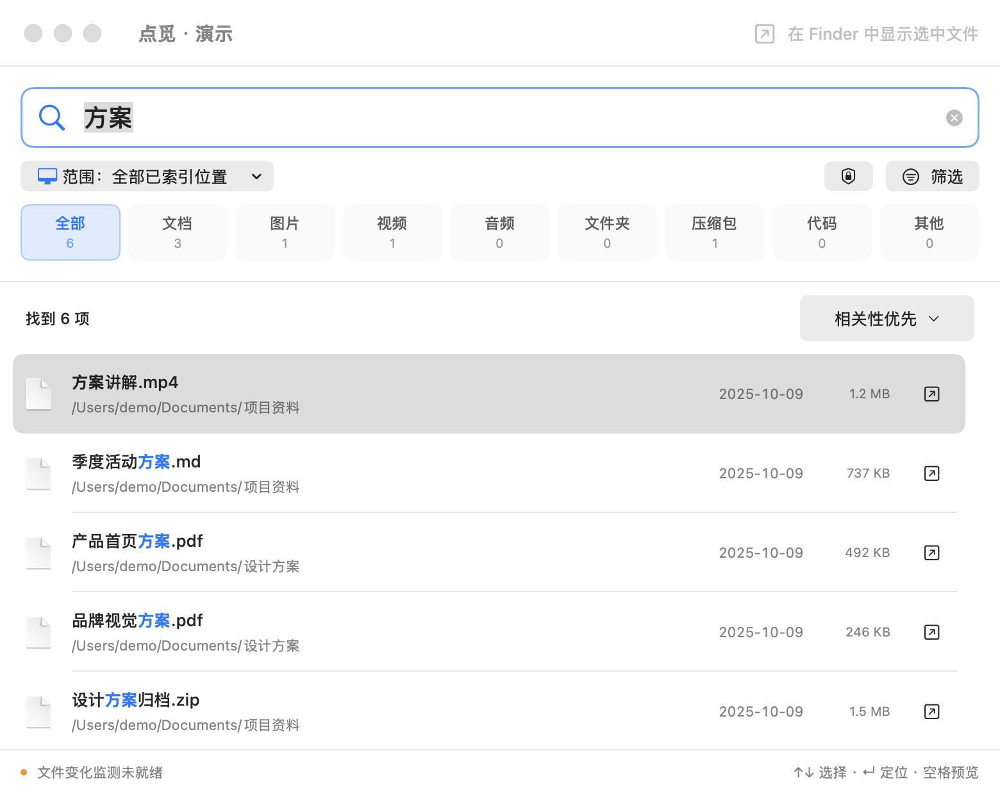

# Dotmi · 点觅

[简体中文](README.md) | **English**

A native macOS filename search app. Find local files by keyword, narrow results by file type, and reveal them in Finder.

This is a personal-project preview. Current local builds use ad hoc signing; a Developer ID–signed and Apple-notarized distribution is not yet available. The app interface is currently primarily in Simplified Chinese; this English README does not imply a fully localized English interface.

## Features

- Search filenames with multiple space-separated keywords, optionally matching the full path.
- Search accessible, non-excluded locations on your Mac, or restrict results to a folder and its subfolders.
- Filter documents, images, videos, audio, folders, archives, code, and other files.
- Save favorite folders and reuse existing indexes when switching search scope.
- Reveal a result in Finder, open it, use Quick Look, or copy its path.
- Distinguish empty results caused by offline locations, access problems, exclusions, incomplete indexing, or active filters.
- Maintain a local SQLite file-information and character-search index, with incremental updates through FSEvents.
- Hide common hidden files and application data by default, with an option to show those already indexed.
- Sort by relevance, name, or modification time; navigate with arrow keys, reveal with Return, and preview with Space in the result list.
- Load 200 results initially, with more available up to 2,000; counts cover all matches. Superseded queries can be cancelled during execution.
- Save recent files and window positions. Choose among three global shortcut combinations, with registration status in Settings.

Full-text content search, OCR, pinyin search, semantic search, and automatic update downloads are not currently provided.

## Screenshots

[](docs/点觅-搜索与类型筛选-codex-2026-10-19-v1.0.png)

Version 1.21 removes grouping in favor of the top category filters. Switching categories selects the first result and scrolls to the top; loading more keeps the selection. This 2× capture uses synthetic data without scanning real folders. It is not a performance benchmark or a demonstration of live file monitoring.

Run `zsh scripts/demo.sh` to view the synthetic demo. It does not scan real directories or change your index and preferences. Demo files cannot actually be opened or revealed. The temporary index is removed when the demo exits.

## Requirements

- Deployment target: macOS 13. Local runtime validation has been performed on macOS 26 with Apple Silicon.
- Swift 5.9 or later, Xcode Command Line Tools, Python 3, and system SQLite.
- Builds target the current machine's architecture by default. Intel builds are configurable, but have not been validated on an Intel Mac.

After installing Apple's command-line tools, confirm that `swift --version` and `python3 --version` work. The app requires no paid API or third-party service account.

## Build and install

```sh
# Build without installing or launching
zsh build.sh

# Build and update the single installation at /Applications/点觅.app
zsh build.sh --install
```

The default output is `xunji-artifacts/点觅.app` in the system temporary directory. To specify another output location:

```sh
zsh build.sh --output /tmp/xunji-preview/点觅.app
```

Keep the application bundle name `点觅.app`. The installer migrates an older `寻迹.app` with the same Bundle ID to this name, avoiding parallel installations. The internal data directory and preferences domain continue to use Xunji for compatibility.

`--install` closes the running app at the matching installation path and replaces it with the validated bundle, preserving indexes and settings. Your user needs write access to `/Applications`. The installer does not change system permissions or disable Gatekeeper.

Set `XUNJI_ARCH=arm64` or `XUNJI_ARCH=x86_64` to request a particular architecture. Successful cross-compilation does not establish runtime compatibility. Use `XUNJI_BUILD_DIR` to specify the temporary SwiftPM build directory.

## First use

1. Choose “整台 Mac” (Entire Mac) or a folder to build the file-information index.
2. Enter filename keywords and narrow results by file type. Category counts cover all matches; 200 results load initially, with more available up to 2,000.
3. Select a result and click “在 Finder 中显示选中文件” (Reveal Selected File in Finder). Use ⌘Y for Quick Look or ⌘Return to open it.
4. “常用文件夹” (Favorite Folders) stores shortcuts without starting duplicate scans. “索引管理” (Index Management) shows coverage and skipped locations.

“Entire Mac” does not mean every system or application file is searchable. System directories, the user's Library, Trash, `.git`, `.build`, and `node_modules` are excluded by default. Packages and symbolic links are not traversed recursively. You can add a specific directory to the index when needed. File permissions, disconnected disks, and cloud files that are not locally available also limit coverage.

If you need protected locations, you may manually add Dotmi under System Settings → Privacy & Security → Full Disk Access. Access is your choice. Updates to ad hoc–signed builds may require macOS to confirm access again. The permission-help entry in the app is explanatory; it is not a permission-status detector.

## Performance and privacy

Initial scans, search-index upgrades, large batches of file changes, and expired event history can increase CPU and disk activity. Normal restarts replay changes made while the app was closed; affected scopes are rescanned when necessary. Background events are coalesced over approximately two seconds. File changes are committed in batches of up to 500 entries rather than one transaction per file. Performance is not guaranteed across all computers and dataset sizes.

Data is stored in `~/Library/Application Support/Xunji/`, including filenames, full paths, file types, sizes, modification times, and index coverage. The app currently has no uploads, accounts, analytics, or telemetry. Previews use macOS Quick Look. See the [privacy notice](PRIVACY.md) (Chinese).

## Validation

```sh
# Core search, Unicode, scope boundaries, filtering, database migration,
# and a benchmark with 100,000 records
zsh scripts/check.sh

# Also run native file-event, favorites, and Quick Look lifecycle checks
zsh scripts/check.sh --integration
```

Installation and performance checks can also run separately after building:

```sh
zsh build.sh --output /tmp/dotmi-check/点觅.app
XUNJI_TEST_APP=/tmp/dotmi-check/点觅.app python3 Tests/verify_install.py
XUNJI_TEST_BINARY=/tmp/dotmi-check/点觅.app/Contents/MacOS/Xunji XUNJI_PERFORMANCE_REPORT=/tmp/dotmi-performance.json python3 Tests/measure_performance.py
```

Installation checks use temporary directories and simulate registration failures to verify rollback; they do not install into `/Applications`. The performance check creates 30,000 synthetic files and reads test-process resource statistics. Results are local samples, not promises for all disks or file collections. Required recovery scans are recorded separately.

Native integration checks require a logged-in macOS desktop with WindowServer access and briefly show test windows. They use isolated directories without scanning real files or writing to your real index. CI runs core checks and builds; those are not a substitute for full desktop validation.

## Development and distribution

Source code is in `Sources/`. The native interface uses SwiftUI/AppKit, and search uses system SQLite/FTS5. See [contributing](CONTRIBUTING.md) and the [release checklist](docs/RELEASING.md) (both Chinese).

The icon source is `Resources/AppIcon.icon`. Modern macOS uses its compiled `Resources/Assets.car`; `AppIcon.icns` is retained for older systems. Regular builds use the committed compiled resources and do not require the full Xcode app. After changing the icon, use full Xcode to run `zsh scripts/compile_icon.sh`, then rebuild. `DEVELOPER_DIR` can select Xcode without changing the system default toolchain.

On a logged-in desktop, run `swift Tests/inspect_icon.swift /Applications/点觅.app /tmp/dotmi-icon-preview.png --require-flat` to inspect the blue letter interiors in the icon actually returned by macOS. This checks the default system icon style and does not replace checking the Dock appearance.

## License

**GNU GPL v3.0 (GPL-3.0-only)**. See [LICENSE](LICENSE) for the full terms. Copyright (C) 2026 点觅 contributors. See [provenance](docs/PROVENANCE.md) (Chinese) for third-party components and reference sources.
